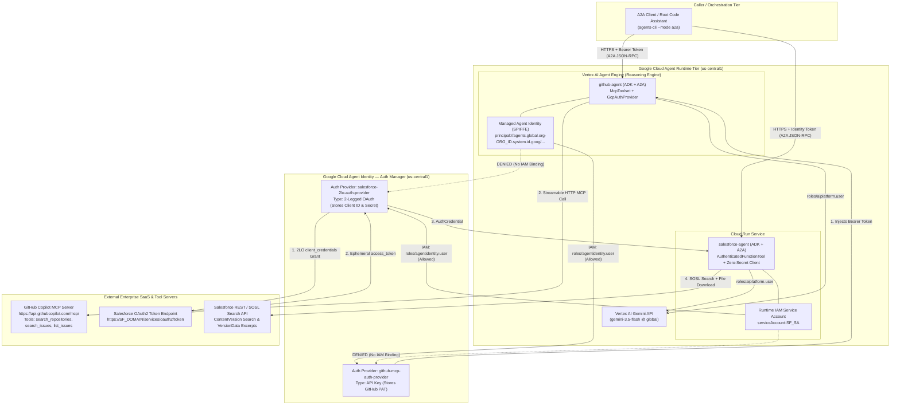
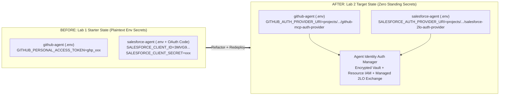
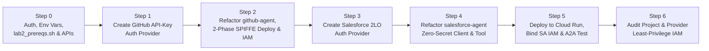
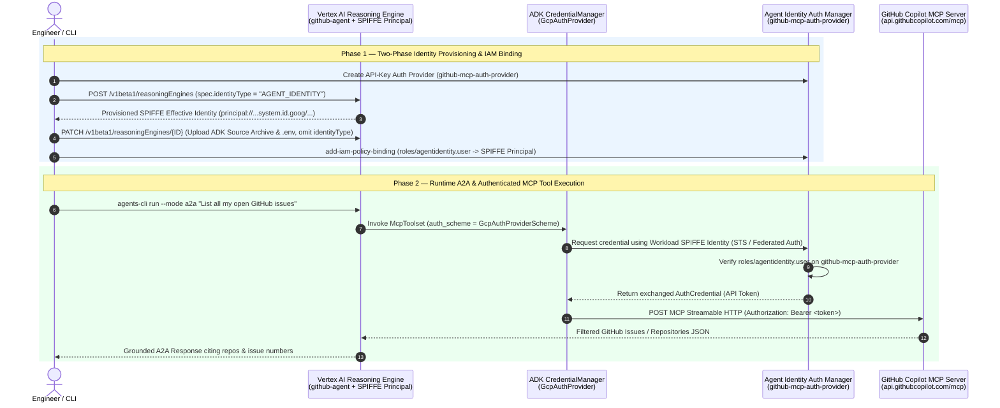
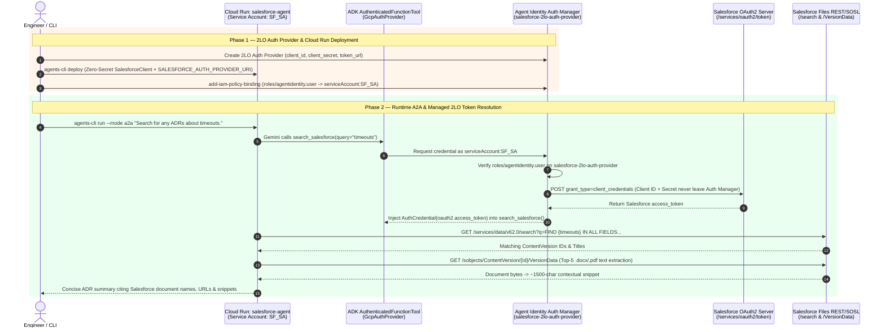

# FDE Agent Identity Foundations — Challenge Lab Runbook (APEX009)

> **End-to-End Implementation Guide, System Architecture, Security Workflows & Troubleshooting Reference**
> Eliminate hardcoded API keys and OAuth client secrets from enterprise AI agents by migrating **Google ADK (Agent Development Kit)** workloads on **Vertex AI Agent Engine** and **Cloud Run** to **Google Cloud Agent Identity & Auth Manager**.

---

## Table of Contents

1. [Executive Overview & Lab Objectives](#1-executive-overview--lab-objectives)
2. [System Architecture](#2-system-architecture)
   - [2.1 Target End-State Architecture](#21-target-end-state-architecture)
   - [2.2 Security Posture Transformation (Before vs. After)](#22-security-posture-transformation-before-vs-after)
   - [2.3 Workload Identity & Auth Provider Matrix](#23-workload-identity--auth-provider-matrix)
3. [End-to-End Workflows](#3-end-to-end-workflows)
   - [3.1 Lab Execution Workflow](#31-lab-execution-workflow)
   - [3.2 Workflow A — `github-agent` (SPIFFE Identity + MCP API-Key Exchange)](#32-workflow-a--github-agent-spiffe-identity--mcp-api-key-exchange)
   - [3.3 Workflow B — `salesforce-agent` (Cloud Run SA + 2LO OAuth Exchange)](#33-workflow-b--salesforce-agent-cloud-run-sa--2lo-oauth-exchange)
4. [Repository Structure](#4-repository-structure)
5. [Step-by-Step Lab Runbook](#5-step-by-step-lab-runbook)
   - [Step 0: Environment Setup, Variables & Lab Prerequisites](#step-0-environment-setup-variables--lab-prerequisites)
   - [Step 1: Create the GitHub API-Key Auth Provider in Auth Manager](#step-1-create-the-github-api-key-auth-provider-in-auth-manager)
   - [Step 2: Refactor `github-agent`, Deploy with SPIFFE Identity & Bind IAM](#step-2-refactor-github-agent-deploy-with-spiffe-identity--bind-iam)
   - [Step 3: Create the Salesforce 2-Legged OAuth (2LO) Auth Provider](#step-3-create-the-salesforce-2-legged-oauth-2lo-auth-provider)
   - [Step 4: Refactor `salesforce-agent` to Zero-Secret `AuthenticatedFunctionTool`](#step-4-refactor-salesforce-agent-to-zero-secret-authenticatedfunctiontool)
   - [Step 5: Deploy `salesforce-agent` to Cloud Run, Bind IAM & Verify A2A](#step-5-deploy-salesforce-agent-to-cloud-run-bind-iam--verify-a2a)
   - [Step 6: Audit Least-Privilege IAM & Blast-Radius Isolation](#step-6-audit-least-privilege-iam--blast-radius-isolation)
6. [Field-Tested Troubleshooting & Pitfalls](#6-field-tested-troubleshooting--pitfalls)

---

## 1. Executive Overview & Lab Objectives

In initial prototypes (Lab 1 / `APEX012`), enterprise sub-agents commonly ship with plaintext third-party credentials injected via `.env` files or container environment variables (`GITHUB_PERSONAL_ACCESS_TOKEN`, `SALESFORCE_CLIENT_ID`, `SALESFORCE_CLIENT_SECRET`). That pattern introduces severe enterprise risks:

- **Secret Sprawl & Leakage**: Credentials appear in Cloud Run revisions, Reasoning Engine specs, build logs, and developer workstations.
- **No Per-Agent Blast-Radius Isolation**: Any process able to inspect environment configuration can exfiltrate long-lived credentials.
- **Manual Token Lifecycle**: Application code has to implement bespoke OAuth 2.0 `client_credentials` handshakes, token caching, and retry logic.

In this **FDE Agent Identity Foundations Challenge Lab (`APEX009`)**, you refactor two production **Agent-to-Agent (A2A)** specialist agents built with **Google ADK (`google-adk[gcp,agent-identity]`)** so that **zero secrets exist in code, `.env` files, or container specs**:

1. **`github-agent` (Vertex AI Agent Engine / Reasoning Engine)**:
   - Provisioned with a **Google-managed federated SPIFFE Agent Identity** (`principal://agents.global.org-<ORG_ID>.system.id.goog/...`).
   - Authenticates to the **GitHub Copilot MCP Server** (`https://api.githubcopilot.com/mcp/`) via ADK's `McpToolset` + `GcpAuthProviderScheme`, resolving the GitHub token dynamically from an **API-Key Auth Provider** (`github-mcp-auth-provider`).
2. **`salesforce-agent` (Cloud Run)**:
   - Runs under a dedicated **Cloud Run IAM Service Account** (`serviceAccount:<SF_SA>`).
   - Searches **Salesforce Files** (Architecture Decision Records & policies in `.docx`/`.pdf`) via SOSL/REST using ADK's `AuthenticatedFunctionTool`, resolving short-lived app tokens on demand from a **2-Legged OAuth (2LO) Auth Provider** (`salesforce-2lo-auth-provider`).
3. **Resource-Level Least-Privilege IAM**:
   - `roles/agentidentity.user` is bound **per Auth Provider**, guaranteeing `github-agent` cannot request Salesforce tokens and `salesforce-agent` cannot request the GitHub token.

---

## 2. System Architecture

### 2.1 Target End-State Architecture



### 2.2 Security Posture Transformation (Before vs. After)



### 2.3 Workload Identity & Auth Provider Matrix

| Dimension | `github-agent` | `salesforce-agent` |
| :--- | :--- | :--- |
| **Hosting Platform** | Vertex AI Agent Engine (`ReasoningEngine`) | Google Cloud Run (`gcloud run`) |
| **Workload Identity** | Managed Federated SPIFFE Principal (`principal://agents.global.org-<ORG>.system.id.goog/...`) | IAM Service Account (`serviceAccount:<SF_SA>`) |
| **Auth Manager Resource** | `github-mcp-auth-provider` | `salesforce-2lo-auth-provider` |
| **Auth Provider Type** | **API Key** (`--api-key`) | **2-Legged OAuth / Client Credentials** (`--two-legged-oauth-*`) |
| **ADK Integration Pattern** | `McpToolset` + `GcpAuthProviderScheme` + `header_provider` | `AuthenticatedFunctionTool` + `AuthConfig` + `AuthCredential` |
| **Secrets in `.env` / Code** | **None** (only `GITHUB_AUTH_PROVIDER_URI`) | **None** (only `SALESFORCE_AUTH_PROVIDER_URI` + `SALESFORCE_DOMAIN`) |
| **Least-Privilege Binding** | `roles/agentidentity.user` on `github-mcp-auth-provider` only | `roles/agentidentity.user` on `salesforce-2lo-auth-provider` only |

---

## 3. End-to-End Workflows

### 3.1 Lab Execution Workflow



### 3.2 Workflow A — `github-agent` (SPIFFE Identity + MCP API-Key Exchange)



### 3.3 Workflow B — `salesforce-agent` (Cloud Run SA + 2LO OAuth Exchange)



---

## 4. Repository Structure

```text
FDE-Agent-Identity-Foundations-Challenge-Lab/
├── README.md                              # Complete Step-by-Step Runbook, Architecture & Workflows
├── LAB_RUNBOOK.md                         # Standalone Runbook copy
├── apex_labs/
│   └── lab2_prereqs.sh                    # Starter environment provisioning script (Lab 1 end-state)
└── agents/
    ├── github-agent/                      # Vertex AI Agent Engine A2A Agent (SPIFFE + MCP API Key)
    │   ├── .env.example                   # Sanitized environment template (no secrets)
    │   ├── Dockerfile                     # Container build definition
    │   ├── deploy_with_identity.sh        # Two-phase REST deployer for AGENT_IDENTITY
    │   └── agent/
    │       ├── agent.py                   # Refactored ADK Agent (GcpAuthProvider + McpToolset)
    │       ├── main.py                    # FastAPI A2A server entrypoint
    │       └── requirements.txt           # google-adk[gcp,agent-identity,a2a,mcp]==2.4.0
    └── salesforce-agent/                  # Cloud Run A2A Agent (Service Account + 2LO OAuth)
        ├── .env.example                   # Sanitized environment template (no secrets)
        ├── Dockerfile                     # Container build definition
        ├── README.md                      # Salesforce sub-agent documentation
        ├── agents-cli-manifest.yaml       # agents-cli 1.0.0 deployment manifest
        ├── pyproject.toml                 # Dependencies (google-adk[gcp,agent-identity])
        ├── uv.lock                        # Locked Python dependencies
        ├── app/
        │   ├── agent.py                   # Refactored ADK Agent + Memory Bank callback
        │   ├── tools.py                   # AuthenticatedFunctionTool + AuthConfig + token extractor
        │   ├── salesforce_client.py       # Zero-credential SOSL search & .docx/.pdf text extractor
        │   ├── fast_api_app.py            # FastAPI + A2A endpoint server
        │   └── app_utils/                 # A2A, telemetry, and service helpers
        ├── deployment/terraform/          # Infrastructure-as-Code templates
        ├── scripts/create_memory_bank.py  # Optional Vertex AI Memory Bank provisioner
        └── tests/                         # Unit, integration, and evaluation suites
```

---

## 5. Step-by-Step Lab Runbook

### Step 0: Environment Setup, Variables & Lab Prerequisites

#### 0.1 Authenticate `gcloud` and Application Default Credentials (ADC)

```bash
gcloud auth login
gcloud auth application-default login
```

#### 0.2 Configure Core Environment Variables

Replace `<YOUR_PROJECT_ID>` with your active Qwiklabs / Google Cloud Project ID:

```bash
export PROJECT_ID="<YOUR_PROJECT_ID>"
export LOCATION="us-central1"
export REGION="us-central1"

gcloud config set project "${PROJECT_ID}"

export PROJECT_NUMBER=$(gcloud projects describe "${PROJECT_ID}" --format='value(projectNumber)')
export ORGANIZATION_ID=$(gcloud projects get-ancestors "${PROJECT_ID}" --format=json \
  | jq -r '.[] | select(.type=="organization") | .id')

echo "Project: ${PROJECT_ID} (${PROJECT_NUMBER}), Org: ${ORGANIZATION_ID}, Location: ${LOCATION}, Region: ${REGION}"
```

#### 0.3 Stage and Execute the Lab 2 Prerequisite Script

If starting in a fresh lab project, pull `apex_labs` from the lab GCS bucket and run `lab2_prereqs.sh` (installs `uv` and `google-agents-cli==1.0.0`, downloads starter agent code into `~/agents/`, and provisions the Lab 1 baseline):

```bash
gcloud storage cp -r "gs://${PROJECT_ID}-bucket/apex_labs" .
bash apex_labs/lab2_prereqs.sh

export PATH="$HOME/.local/bin:$PATH"
agents-cli info
```

#### 0.4 Enable Agent Identity, Credentials & STS APIs

```bash
gcloud services enable \
  iam.googleapis.com \
  agentidentity.googleapis.com \
  aiplatform.googleapis.com \
  agentidentitycredentials.googleapis.com \
  iamcredentials.googleapis.com \
  sts.googleapis.com \
  --project="${PROJECT_ID}"
```

---

### Step 1: Create the GitHub API-Key Auth Provider in Auth Manager

Instead of passing `GITHUB_PERSONAL_ACCESS_TOKEN` in `.env`, store your GitHub Personal Access Token inside a managed **Agent Identity Auth Provider** resource.

```bash
# 1. Securely read your GitHub PAT without echoing to terminal history
echo -n "Enter GitHub PAT: " && read -rs GITHUB_PAT && echo

# 2. Create the API-Key Auth Provider in us-central1
gcloud alpha agent-identity auth-providers create github-mcp-auth-provider \
  --project="${PROJECT_ID}" \
  --location="${LOCATION}" \
  --api-key="${GITHUB_PAT}"

# 3. Verify the provider exists with state: ENABLED
gcloud alpha agent-identity auth-providers list \
  --project="${PROJECT_ID}" \
  --location="${LOCATION}"

# 4. Export the Auth Provider full resource URI
export GITHUB_AUTH_PROVIDER_URI="projects/${PROJECT_ID}/locations/${LOCATION}/authProviders/github-mcp-auth-provider"
echo "${GITHUB_AUTH_PROVIDER_URI}"
```

---

### Step 2: Refactor `github-agent`, Deploy with SPIFFE Identity & Bind IAM

#### 2.1 Remove Plaintext PAT from `~/agents/github-agent/.env`

Replace `GITHUB_PERSONAL_ACCESS_TOKEN` with the non-secret `GITHUB_AUTH_PROVIDER_URI`:

```bash
cd ~/agents/github-agent

cat << EOF > .env
GOOGLE_CLOUD_PROJECT=${PROJECT_ID}
GOOGLE_CLOUD_LOCATION=global
GOOGLE_GENAI_USE_VERTEXAI=True
MODEL=gemini-3.5-flash
GITHUB_MCP_URL=https://api.githubcopilot.com/mcp/
GITHUB_AUTH_PROVIDER_URI=projects/${PROJECT_ID}/locations/${LOCATION}/authProviders/github-mcp-auth-provider
EOF
```

#### 2.2 Refactor `~/agents/github-agent/agent/agent.py`

Register `GcpAuthProvider` with ADK's `CredentialManager`, define `GcpAuthProviderScheme`, and wire `McpToolset` with `github_header_provider` and a read-only `tool_filter`:

```bash
cat << 'EOF' > ~/agents/github-agent/agent/agent.py
import os
from dotenv import load_dotenv
from google.adk.agents import Agent
from google.adk.apps import App
from google.adk.auth.credential_manager import CredentialManager
from google.adk.integrations.agent_identity import GcpAuthProvider, GcpAuthProviderScheme
from google.adk.models import Gemini
from google.adk.tools.mcp_tool import McpToolset, StreamableHTTPConnectionParams
from google.genai import types

load_dotenv()

MODEL = os.environ["MODEL"]
GITHUB_MCP_URL = os.getenv("GITHUB_MCP_URL", "https://api.githubcopilot.com/mcp/")
GITHUB_AUTH_PROVIDER_URI = os.environ["GITHUB_AUTH_PROVIDER_URI"]
GITHUB_TOOL_FILTER = ["search_repositories", "search_issues", "list_issues"]

# 1. Register the Google Cloud Agent Identity auth provider
CredentialManager.register_auth_provider(GcpAuthProvider())

# 2. Reference the Auth Manager API-Key auth provider resource
github_auth_scheme = GcpAuthProviderScheme(name=GITHUB_AUTH_PROVIDER_URI)


def github_mcp_toolset() -> McpToolset:
    """MCP toolset for the GitHub server, authenticated via Auth Manager."""
    toolset = None

    def github_header_provider(readonly_ctx) -> dict[str, str]:
        if not toolset or not toolset.get_auth_config():
            return {}
        auth_config = toolset.get_auth_config()
        cred = None
        if readonly_ctx and hasattr(readonly_ctx, "get_credential"):
            cred = readonly_ctx.get_credential(auth_config.credential_key)
        if not cred:
            cred = auth_config.exchanged_auth_credential
        if not cred or not cred.http:
            return {}
        token = None
        if cred.http.credentials and cred.http.credentials.token:
            token = cred.http.credentials.token
        elif cred.http.additional_headers:
            token = cred.http.additional_headers.get(
                "X-API-Key"
            ) or cred.http.additional_headers.get("X-GOOG-API-KEY")
        if token:
            return {"Authorization": f"Bearer {token}"}
        return {}

    # 3. Build and return the authenticated McpToolset
    toolset = McpToolset(
        connection_params=StreamableHTTPConnectionParams(url=GITHUB_MCP_URL),
        auth_scheme=github_auth_scheme,
        tool_filter=GITHUB_TOOL_FILTER,
        header_provider=github_header_provider,
    )
    return toolset


root_agent = Agent(
    name="github_agent",
    model=Gemini(
        model=MODEL,
        retry_options=types.HttpRetryOptions(attempts=3),
    ),
    description=(
        "Specialized assistant for GitHub: searches repositories, issues, and "
        "pull requests via the GitHub MCP server."
    ),
    instruction=(
        "You are a specialized assistant for interacting with GitHub. "
        "Use the provided tools to search for repositories, find issues, and "
        "retrieve pull-request information, then answer with what you find. "
        "Be concise and cite the repository names / issue numbers you used."
    ),
    tools=[github_mcp_toolset()],
)

app = App(root_agent=root_agent, name="app")
EOF
```

#### 2.3 Deploy `github-agent` to Vertex AI Agent Engine with Managed SPIFFE Identity

> **Why `deploy_with_identity.sh`?** Vertex AI Reasoning Engine requires provisioning `spec.identityType = "AGENT_IDENTITY"` in an initial empty `POST` call before uploading the inline source archive via `PATCH` (without touching `identityType`).

```bash
cd ~/agents/github-agent
chmod +x ./deploy_with_identity.sh

REGION="${REGION}" \
A2A_APP_NAME="agent" \
DISPLAY_NAME="github-agent-v2" \
./deploy_with_identity.sh
```

#### 2.4 Retrieve the Deployed Reasoning Engine ID & SPIFFE Principal

Query the `v1beta1` Reasoning Engines API to capture the exact `ENGINE_ID` and `effectiveIdentity`:

```bash
curl -s -H "Authorization: Bearer $(gcloud auth print-access-token)" \
  "https://${REGION}-aiplatform.googleapis.com/v1beta1/projects/${PROJECT_ID}/locations/${REGION}/reasoningEngines" \
  | jq -r '.reasoningEngines[] | "Display Name: \(.displayName)\nEngine ID:    \(.name | split("/")[-1])\nIdentity:     \(.spec.effectiveIdentity // "N/A")\n"'

export GITHUB_ENGINE_ID=$(curl -s -H "Authorization: Bearer $(gcloud auth print-access-token)" \
  "https://${REGION}-aiplatform.googleapis.com/v1beta1/projects/${PROJECT_ID}/locations/${REGION}/reasoningEngines" \
  | jq -r '.reasoningEngines[] | select(.displayName=="github-agent-v2") | .name | split("/")[-1]' | head -n 1)

export GITHUB_AGENT_IDENTITY="principal://agents.global.org-${ORGANIZATION_ID}.system.id.goog/resources/aiplatform/projects/${PROJECT_NUMBER}/locations/${REGION}/reasoningEngines/${GITHUB_ENGINE_ID}"
export GITHUB_AGENT_URL="https://${REGION}-aiplatform.googleapis.com/v1/projects/${PROJECT_NUMBER}/locations/${REGION}/reasoningEngines/${GITHUB_ENGINE_ID}"

echo "Engine ID : ${GITHUB_ENGINE_ID}"
echo "Identity  : ${GITHUB_AGENT_IDENTITY}"
echo "Agent URL : ${GITHUB_AGENT_URL}"
```

#### 2.5 Grant Resource-Level IAM on `github-mcp-auth-provider` & Test via A2A

```bash
# 1. Grant the deployed agent's SPIFFE identity permission to use github-mcp-auth-provider
gcloud alpha agent-identity auth-providers add-iam-policy-binding github-mcp-auth-provider \
  --project="${PROJECT_ID}" \
  --location="${LOCATION}" \
  --role="roles/agentidentity.user" \
  --member="${GITHUB_AGENT_IDENTITY}"

# 2. (Optional) Grant your student account access for local testing
STUDENT_EMAIL=$(gcloud config get-value account)
gcloud alpha agent-identity auth-providers add-iam-policy-binding github-mcp-auth-provider \
  --project="${PROJECT_ID}" \
  --location="${LOCATION}" \
  --role="roles/agentidentity.user" \
  --member="user:${STUDENT_EMAIL}"

# 3. Verify end-to-end A2A execution
agents-cli run --url "${GITHUB_AGENT_URL}" --mode a2a --app-name agent "List all my open GitHub issues"
```

---

### Step 3: Create the Salesforce 2-Legged OAuth (2LO) Auth Provider

Configure Auth Manager to hold the Salesforce Connected App credentials (`client_id` and `client_secret`) and perform the OAuth 2.0 `client_credentials` exchange against your Salesforce My Domain token endpoint.

```bash
# 1. Set your Salesforce My Domain host (no https://) and Connected App Consumer Key
export SF_DOMAIN="<YOUR_ORG>.develop.my.salesforce.com"
export SF_CLIENT_ID="<YOUR_SALESFORCE_CONSUMER_KEY>"

# 2. Securely read your Connected App Consumer Secret
echo -n "Enter Salesforce Consumer Secret: " && read -rs SF_CLIENT_SECRET && echo

# 3. Create the 2LO Auth Provider (Note: flag is --two-legged-oauth-token-url)
gcloud alpha agent-identity auth-providers create salesforce-2lo-auth-provider \
  --project="${PROJECT_ID}" \
  --location="${LOCATION}" \
  --two-legged-oauth-client-id="${SF_CLIENT_ID}" \
  --two-legged-oauth-client-secret="${SF_CLIENT_SECRET}" \
  --two-legged-oauth-token-url="https://${SF_DOMAIN}/services/oauth2/token"

# 4. Confirm BOTH auth providers show state: ENABLED
gcloud alpha agent-identity auth-providers list \
  --project="${PROJECT_ID}" \
  --location="${LOCATION}"

# 5. Export the Salesforce Auth Provider URI
export SALESFORCE_AUTH_PROVIDER_URI="projects/${PROJECT_ID}/locations/${LOCATION}/authProviders/salesforce-2lo-auth-provider"
echo "${SALESFORCE_AUTH_PROVIDER_URI}"
```

---

### Step 4: Refactor `salesforce-agent` to Zero-Secret `AuthenticatedFunctionTool`

#### 4.1 Refactor `~/agents/salesforce-agent/app/salesforce_client.py`

Remove all credential fields (`client_id`, `client_secret`), OAuth token endpoints, and local token caches from `SalesforceClient` so it accepts a per-call `access_token` resolved by Auth Manager:

```python
class SalesforceClient:
    """Credential-free client to search Salesforce Files.

    Holds only the org's My Domain and REST API version. The app access token is
    resolved by Auth Manager and passed in per call; the REST instance URL is
    derived from the My Domain (``https://<domain>``).
    """

    def __init__(self, domain: str, api_version: str | None = None):
        self.domain = domain.replace("https://", "").replace("http://", "").strip("/")
        self.api_version = api_version or _DEFAULT_API_VERSION
        self.instance_url = f"https://{self.domain}"

    def download_version_text(self, access_token: str, version_id: str, name: str) -> str:
        resp = requests.get(
            f"{self.instance_url}/services/data/{self.api_version}"
            f"/sobjects/ContentVersion/{version_id}/VersionData",
            headers={"Authorization": f"Bearer {access_token}"},
            timeout=_CONTENT_TIMEOUT_SECONDS,
        )
        _raise_for_status(resp)
        return _extract_text(name, resp.content)

    def search_files(self, access_token: str, query: str) -> list:
        resp = requests.get(
            f"{self.instance_url}/services/data/{self.api_version}/search",
            headers={"Authorization": f"Bearer {access_token}"},
            params={"q": _build_sosl(query)},
            timeout=_TIMEOUT_SECONDS,
        )
        _raise_for_status(resp)
        # Downloads top-5 hits and extracts ~1500-char snippets around query terms...
```

*(See full implementation in [`agents/salesforce-agent/app/salesforce_client.py`](agents/salesforce-agent/app/salesforce_client.py).)*

#### 4.2 Refactor `~/agents/salesforce-agent/app/tools.py`

Register `GcpAuthProvider`, create `AuthConfig` pointing to `SALESFORCE_AUTH_PROVIDER_URI`, accept `credential: AuthCredential` in `search_salesforce`, and wrap it in `AuthenticatedFunctionTool`:

```bash
cat << 'EOF' > ~/agents/salesforce-agent/app/tools.py
import os
from google.adk.auth.auth_credential import AuthCredential
from google.adk.auth.auth_tool import AuthConfig
from google.adk.auth.credential_manager import CredentialManager
from google.adk.integrations.agent_identity import (
    GcpAuthProvider,
    GcpAuthProviderScheme,
)
from google.adk.tools.authenticated_function_tool import AuthenticatedFunctionTool
from app.salesforce_client import SalesforceClient

SALESFORCE_AUTH_PROVIDER_URI = os.environ["SALESFORCE_AUTH_PROVIDER_URI"]

# 1. Register the Google Cloud auth provider and build AuthConfig
CredentialManager.register_auth_provider(GcpAuthProvider())
salesforce_auth_config = AuthConfig(
    auth_scheme=GcpAuthProviderScheme(name=SALESFORCE_AUTH_PROVIDER_URI)
)


def _extract_token(credential: AuthCredential) -> str | None:
    """Pulls the access token out of the credential Auth Manager resolved."""
    if not credential:
        return None
    if credential.oauth2 and credential.oauth2.access_token:
        return credential.oauth2.access_token
    if (
        credential.http
        and credential.http.credentials
        and credential.http.credentials.token
    ):
        return credential.http.credentials.token
    if credential.http and credential.http.additional_headers:
        h = credential.http.additional_headers
        return (
            h.get("X-API-Key")
            or h.get("X-GOOG-API-KEY")
            or h.get("Authorization", "").replace("Bearer ", "")
            or None
        )
    return None


def build_search_salesforce(client: SalesforceClient):
    """Builds the Salesforce search tool bound to a credential-free client."""

    # 2. Accept `credential: AuthCredential` injected by ADK at tool-call time
    def search_salesforce(query: str, credential: AuthCredential) -> dict:
        """Searches the company's Salesforce document library (Files)."""
        access_token = _extract_token(credential)
        if not access_token:
            return {
                "status": "error",
                "error_message": "Salesforce auth failed: no token from Auth Manager.",
            }

        try:
            documents = client.search_files(access_token, query)
        except Exception as e:
            return {
                "status": "error",
                "error_message": f"Salesforce search failed: {e}",
            }

        return {
            "status": "success",
            "query": query,
            "data": documents,
        }

    # 3. Return an AuthenticatedFunctionTool wrapping search_salesforce
    return AuthenticatedFunctionTool(
        func=search_salesforce, auth_config=salesforce_auth_config
    )
EOF
```

#### 4.3 Refactor `~/agents/salesforce-agent/app/agent.py`

Update `agent.py` to initialize `SalesforceClient` with `SALESFORCE_DOMAIN` only:

```bash
cat << 'EOF' > ~/agents/salesforce-agent/app/agent.py
import os
from dotenv import load_dotenv
from google.adk.agents import Agent
from google.adk.agents.callback_context import CallbackContext
from google.adk.apps import App
from google.adk.models import Gemini
from google.adk.tools.preload_memory_tool import PreloadMemoryTool
from google.genai import types
from app.salesforce_client import SalesforceClient
from app.tools import build_search_salesforce

load_dotenv()

MODEL = os.environ["MODEL"]
SALESFORCE_DOMAIN = os.environ["SALESFORCE_DOMAIN"]

salesforce_client = SalesforceClient(
    domain=SALESFORCE_DOMAIN,
    api_version=os.environ.get("SALESFORCE_API_VERSION"),
)
search_salesforce = build_search_salesforce(salesforce_client)


async def generate_memories_callback(callback_context: CallbackContext) -> None:
    """Persist long-term memories from the current session."""
    await callback_context.add_session_to_memory()


root_agent = Agent(
    name="salesforce_agent",
    model=Gemini(
        model=MODEL,
        retry_options=types.HttpRetryOptions(attempts=3),
    ),
    description=(
        "Specialized assistant for Salesforce: searches the organization's "
        "document library (Salesforce Files) via the Salesforce REST/SOSL API."
    ),
    instruction=(
        "You are the Salesforce Specialist Agent. "
        "To answer any question you MUST call the `search_salesforce` tool, "
        "passing the user's clean question as the query; never answer from your own "
        "knowledge. "
        "The search spans every document (file) the organization has uploaded, "
        "so you do not need a file name or folder from the user - just pass "
        "their query to `search_salesforce`. "
        "After the tool returns, answer with what you found: be concise, cite "
        "the document names / URLs you used, and quote the returned snippets "
        "when they help answer the question. "
        "If the tool returns no results, say so plainly. "
        "If you recall relevant details about the user from earlier "
        "conversations, use them to tailor your search and answer."
    ),
    tools=[search_salesforce, PreloadMemoryTool()],
    after_agent_callback=generate_memories_callback,
)

app = App(root_agent=root_agent, name="app")
EOF
```

#### 4.4 Scrub Secrets from `.env` & Add `agent-identity` Extra to `pyproject.toml`

```bash
cd ~/agents/salesforce-agent

# 1. Remove client ID & client secret from .env and append SALESFORCE_AUTH_PROVIDER_URI
sed -i '/^SALESFORCE_CLIENT_ID=/d; /^SALESFORCE_CLIENT_SECRET=/d; /^SALESFORCE_AUTH_PROVIDER_URI=/d' .env
echo "SALESFORCE_AUTH_PROVIDER_URI=projects/${PROJECT_ID}/locations/${LOCATION}/authProviders/salesforce-2lo-auth-provider" >> .env
cat .env

# 2. Add the agent-identity extra to google-adk and regenerate uv.lock
sed -i 's/google-adk\[gcp\]/google-adk[gcp,agent-identity]/' pyproject.toml
uv lock
```

---

### Step 5: Deploy `salesforce-agent` to Cloud Run, Bind IAM & Verify A2A

#### 5.1 Deploy the Refactored Agent to Cloud Run

```bash
cd ~/agents/salesforce-agent

agents-cli deploy \
  --project "${PROJECT_ID}" \
  --region "${REGION}" \
  --max-instances 4 \
  --no-confirm-project \
  --update-env-vars "$(grep -v '^#' .env | grep -v '^$' | grep -v '^GOOGLE_CLOUD_PROJECT' | paste -sd,)"
```

*(If running with `--no-wait`, poll progress using `agents-cli deploy --status` until completion.)*

#### 5.2 Grant Resource-Level IAM on `salesforce-2lo-auth-provider`

```bash
# 1. Retrieve the Cloud Run runtime Service Account
export SF_SA=$(gcloud run services describe salesforce-agent \
  --region "${REGION}" \
  --format='value(spec.template.spec.serviceAccountName)')
echo "Salesforce Agent Service Account: ${SF_SA}"

# 2. Grant roles/agentidentity.user ONLY on salesforce-2lo-auth-provider
gcloud alpha agent-identity auth-providers add-iam-policy-binding salesforce-2lo-auth-provider \
  --project="${PROJECT_ID}" \
  --location="${LOCATION}" \
  --role="roles/agentidentity.user" \
  --member="serviceAccount:${SF_SA}"

# 3. (Optional) Grant student user access for local testing
STUDENT_EMAIL=$(gcloud config get-value account)
gcloud alpha agent-identity auth-providers add-iam-policy-binding salesforce-2lo-auth-provider \
  --project="${PROJECT_ID}" \
  --location="${LOCATION}" \
  --role="roles/agentidentity.user" \
  --member="user:${STUDENT_EMAIL}"
```

#### 5.3 Disable IAP for CLI Identity Token Testing & Run A2A Query

```bash
# Allow Cloud Run IAM identity token authentication from agents-cli
gcloud run services update salesforce-agent --region="${REGION}" --no-iap

# Fetch the Cloud Run URL and execute an A2A search query
export SF_URL=$(gcloud run services describe salesforce-agent \
  --region "${REGION}" \
  --format='value(status.url)')

agents-cli run --url "${SF_URL}" --mode a2a \
  "Search for any architecture decision records about timeouts."
```

---

### Step 6: Audit Least-Privilege IAM & Blast-Radius Isolation

Verify that neither agent holds excessive project-wide privileges and that each Auth Provider trusts only its designated workload principal:

```bash
# 1. Inspect project-level roles for github-agent's SPIFFE identity
gcloud projects get-iam-policy "${PROJECT_ID}" \
  --flatten="bindings[].members" \
  --filter="bindings.members:${GITHUB_AGENT_IDENTITY}" \
  --format="table(bindings.role)"

# 2. Inspect project-level roles for salesforce-agent's Cloud Run Service Account
gcloud projects get-iam-policy "${PROJECT_ID}" \
  --flatten="bindings[].members" \
  --filter="bindings.members:serviceAccount:${SF_SA}" \
  --format="table(bindings.role)"

# 3. Inspect resource-level IAM policies on each Auth Provider (Blast-Radius Isolation)
gcloud alpha agent-identity auth-providers get-iam-policy github-mcp-auth-provider \
  --project="${PROJECT_ID}" --location="${LOCATION}"

gcloud alpha agent-identity auth-providers get-iam-policy salesforce-2lo-auth-provider \
  --project="${PROJECT_ID}" --location="${LOCATION}"
```

---

## 6. Field-Tested Troubleshooting & Pitfalls

| Symptom / Error | Root Cause | Resolution |
| :--- | :--- | :--- |
| **`Reasoning Engine resource [...] failed to start and cannot serve traffic`** during `agents-cli deploy --agent-identity` | Setting `spec.identityType = "AGENT_IDENTITY"` in the same REST request as `sourceCodeSpec` fails on current Reasoning Engine backends. | Use [`deploy_with_identity.sh`](agents/github-agent/deploy_with_identity.sh), which splits deployment into: (1) `POST` with `identityType` only, and (2) `PATCH` with `sourceArchive` & `env` excluding `identityType` from `updateMask`. |
| **`unrecognized arguments: --two-legged-oauth-token-endpoint`** | `gcloud alpha agent-identity auth-providers create` uses `--two-legged-oauth-token-url` for the OAuth2 token endpoint. | Replace `--two-legged-oauth-token-endpoint` with `--two-legged-oauth-token-url="https://${SF_DOMAIN}/services/oauth2/token"`. |
| **Incomplete SPIFFE principal (`.../reasoningEngines/` with missing ID)** in IAM policy | `gcloud ai reasoning-engines list` may omit `effectiveIdentity` or filter mismatches if `displayName` differs. | Query `v1beta1/projects/${PROJECT_ID}/locations/${REGION}/reasoningEngines` via `curl` + `jq`, remove stale binding with `remove-iam-policy-binding`, and re-bind with the full Engine ID. |
| **`401` / `403` HTML response when running `agents-cli run` against Cloud Run** | Cloud Run Identity-Aware Proxy (IAP) intercepts `agents-cli` OIDC identity tokens. | Run `gcloud run services update salesforce-agent --region=${REGION} --no-iap` so Cloud Run validates caller IAM directly. |
| **`MemAllocPerProjectRegion` quota exceeded on Cloud Run deploy** | Default `max-instances=10` at `4Gi` per instance (`40Gi`) exceeds the lab project's `32Gi` regional quota. | Pass `--max-instances 4` (`16Gi` max) to `agents-cli deploy`. |
| **`ModuleNotFoundError: google.adk.integrations.agent_identity`** | `google-adk` installed without the `agent-identity` optional extra, or `uv.lock` not refreshed before container build. | Update `pyproject.toml` to `google-adk[gcp,agent-identity]` and run `uv lock` prior to `agents-cli deploy`. |
| **Salesforce SOSL returns empty `data: []` immediately after uploading `.docx` files** | Salesforce full-text search indexing (`ContentVersion`) has an asynchronous indexing lag (~10–15 minutes) and requires Run-As user file visibility. | Grant **Query All Files** + **View All Data** (or Library access) to the Connected App's Run-As user and wait ~15 minutes for SOSL indexing. |
